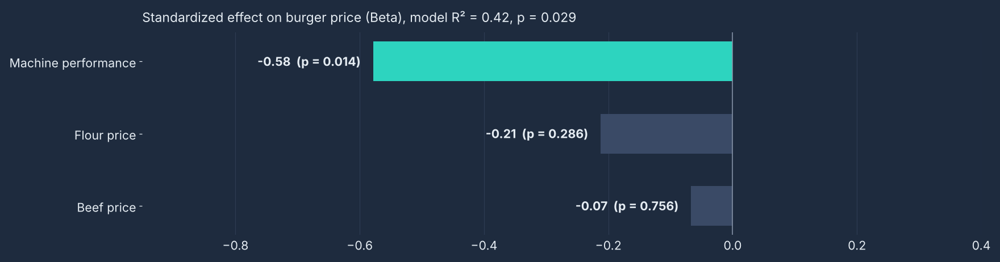
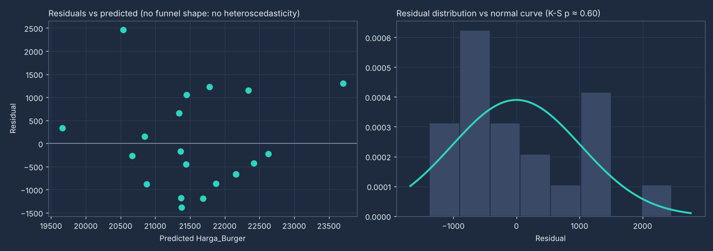

# Regression Assumption Testing with SPSS

Multiple regression on a course practice dataset (20 observations), with every classical assumption checked before interpreting the model.

> The datasets here are course practice data. Results illustrate the method, not real-world conclusions.

## Question
Which of beef price, flour price, and machine performance explain burger price, and does the model meet the classical regression assumptions?

## Method
Kolmogorov-Smirnov normality test, multiple regression, residual normality test, VIF (multicollinearity), Glejser test (heteroscedasticity), and Durbin-Watson (autocorrelation).

## Results

| Check | Result |
|---|---|
| Model fit | R² = 0.42, F(3, 16) = 3.90, p = 0.029 |
| Significant predictor | Machine performance (B = -1.31, p = 0.014) |
| Normality of residuals | K-S p ≈ 0.60 |
| Multicollinearity | VIF 1.02 to 1.24 |
| Heteroscedasticity | Glejser p > 0.05 for all predictors |
| Autocorrelation | Durbin-Watson = 2.19 |

## Files
- `*.sav`: the practice datasets (regression assumptions, multiple regression, binary logistic)
- `1_` to `7_*.spv`: PSPP/SPSS output files (frequencies, t-tests, non-parametric tests, logistic regression, path analysis, multiple regression, assumption testing)
- `spss_cover.png`, `spss_diagnostics.png`: charts used on the portfolio page

## Tools
SPSS-compatible output created with GNU PSPP. Open `.sav` and `.spv` files in PSPP or SPSS.
